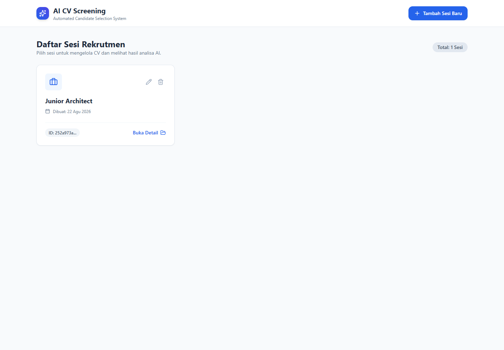
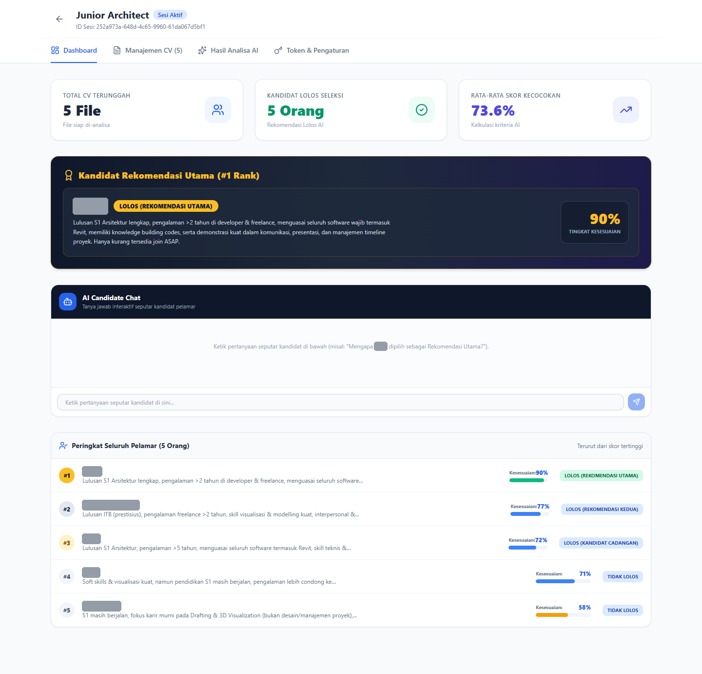
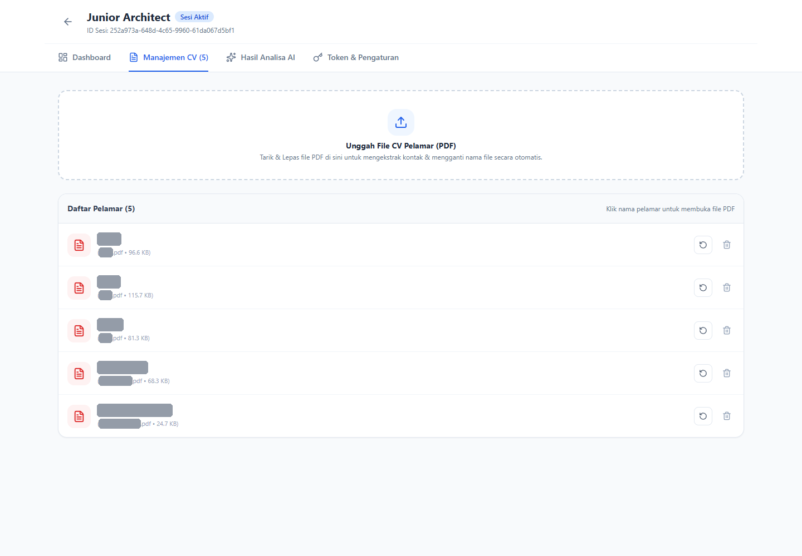
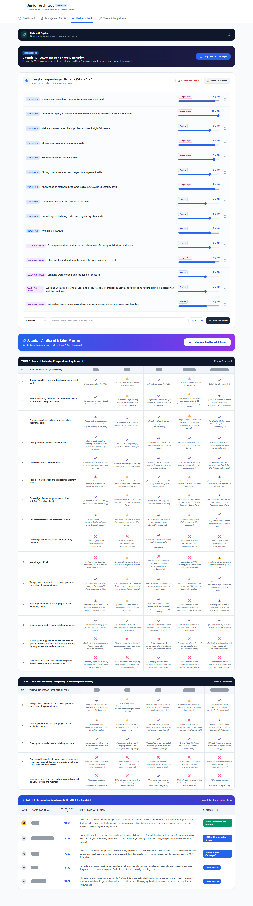
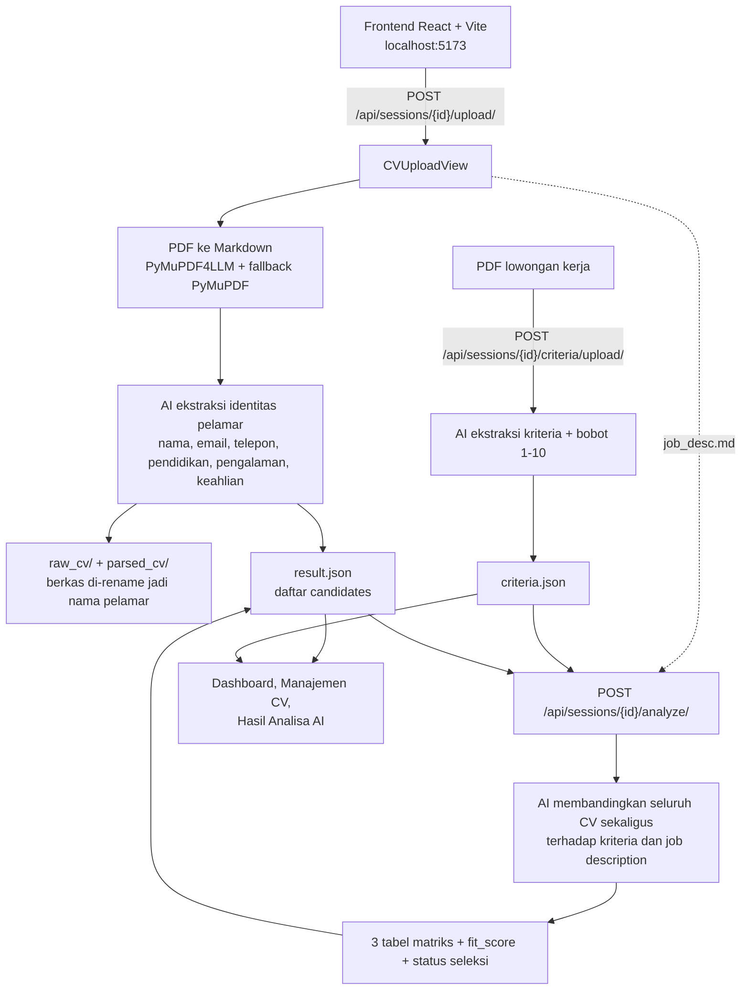

# AI CV Screening

**Screening CV massal:** PDF → Markdown → matriks perbandingan 3 tabel berperingkat per lowongan.

Aplikasi web untuk menyaring CV pelamar secara massal: PDF diubah menjadi Markdown, identitas & kontak pelamar diekstrak otomatis, lalu **seluruh kandidat dibandingkan sekaligus** terhadap deskripsi lowongan memakai LLM dan menghasilkan **3 tabel matriks evaluasi komparatif** lengkap dengan skor kecocokan dan status seleksi.

Dibuat untuk tim rekrutmen yang harus memilah puluhan sampai ratusan CV per lowongan: unggah PDF lowongan kerja → kriteria beserta bobot prioritas (1–10) diekstrak otomatis → unggah semua CV → jalankan analisa → hasil peringkat siap ditinjau, tanpa membaca tiap CV manual.

> **Status: alat internal / pengembangan lokal.** Belum ada autentikasi, `DEBUG=True`, CORS terbuka, dan AI dijalankan sinkron di dalam request HTTP. Jalankan hanya di komputer sendiri; lihat [Batasan & Catatan Keamanan](#batasan--catatan-keamanan) sebelum memakai data pelamar asli atau mengeksposnya ke jaringan.

## Tangkapan Layar

Sesi rekrutmen dibuat per lowongan; tiap sesi menyimpan CV, kriteria, dan hasil analisanya sendiri.



Dashboard sesi: statistik ringkas, kandidat peringkat #1, dan chatbot tanya-jawab kandidat.



Manajemen CV: unggah banyak PDF sekaligus, kontak pelamar terekstrak, nama file di harddisk otomatis menjadi nama pelamar.



Hasil analisa AI: kriteria + bobot, Tabel 1 (kualifikasi), Tabel 2 (tanggung jawab), Tabel 3 (kesimpulan & status seleksi).



> Nama pelamar pada tangkapan layar di atas disamarkan; data aslinya tidak dipublikasikan di repository ini.

## Fitur Utama

- **Sesi rekrutmen**: buat, ubah nama, dan hapus sesi (satu sesi = satu lowongan, datanya terpisah di disk).
- **Unggah banyak CV PDF sekaligus** lewat drag-and-drop; tiap file diproses satu per satu dan hasilnya langsung muncul tanpa menunggu seluruh batch selesai.
- **Konversi PDF → Markdown** dengan PyMuPDF4LLM, dengan fallback PyMuPDF bila halaman tidak punya lapisan teks.
- **Ekstraksi identitas pelamar** dalam satu panggilan AI: nama, email, telepon, domisili, riwayat pendidikan, pengalaman profesi (posisi, perusahaan, durasi), dan keahlian (hard/soft skills).
- **Auto-rename berkas**: `raw_cv/<nama file asli>.pdf` diubah menjadi `raw_cv/<Nama Pelamar>.pdf` (dan file Markdown-nya ikut), sehingga isi folder mudah diperiksa.
- **Ekstraksi kriteria dari PDF lowongan kerja**: kualifikasi dan tanggung jawab beserta bobot prioritas 1–10 dihasilkan otomatis; kriteria juga bisa ditambah/diubah manual dan dihapus massal.
- **Analisa 3 tabel komparatif** dalam satu panggilan AI: Tabel 1 evaluasi persyaratan, Tabel 2 evaluasi tanggung jawab (simbol ✔️ / ⚠️ / ❌ per kandidat per baris), Tabel 3 kesimpulan berisi `fit_score`, catatan utama, dan status seleksi (`LOLOS (Rekomendasi Utama/Kedua/Cadangan)` / `TIDAK LOLOS`).
- **Chatbot kandidat**: tanya-jawab bebas seputar pelamar pada sesi tersebut (jawaban hanya bersumber dari job description, kriteria, dan hasil analisa sesi itu).
- **Proses ulang per berkas**: satu CV bisa dievaluasi ulang dengan AI tanpa memproses ulang seluruh batch.
- **Monitor token & estimasi biaya**: prompt/completion token setiap panggilan diakumulasi dan dikonversi ke estimasi USD.
- **Semua hasil tersimpan sebagai berkas** (`.md`, `.json`) di folder sesi, jadi bisa diperiksa, dicadangkan, atau diproses ulang di luar aplikasi.
- **Pemilihan model**: 51 model Qwen via OpenRouter, default `qwen/qwen3.8-max`.

## Alur Kerja



Semua panggilan AI dilakukan backend ke `https://openrouter.ai/api/v1/chat/completions`; hasil JSON dari model dibersihkan dan diperbaiki (`json-repair`) sebelum disimpan.

## Teknologi

| Komponen | Teknologi | Versi teruji |
| --- | --- | --- |
| Bahasa & framework backend | Python, Django | 3.14.6, Django 6.1 |
| REST API | Django REST Framework | 3.18.0 |
| CORS | django-cors-headers | 4.9.0 |
| Database | SQLite (bawaan Django) | - |
| HTTP client ke OpenRouter | requests | 2.34.x |
| Konversi PDF → Markdown | PyMuPDF4LLM + PyMuPDF, fallback teks halaman | 1.28.2 |
| Perbaikan JSON keluaran LLM | json-repair (opsional, ada fallback parser) | 0.63.3 |
| Konfigurasi | python-dotenv (`.env`) | - |
| LLM | OpenRouter API, model Qwen | default `qwen/qwen3.8-max` |
| UI | React, Vite | 19.2.8, 8.2.0 |
| Routing & HTTP | react-router-dom, axios | 7.18.2, 1.19.0 |
| Styling | Tailwind CSS + PostCSS/autoprefixer | 3.4.19 |
| Ikon & lint | lucide-react, oxlint | 1.33.0, 1.75.0 |

## Prasyarat

| Kebutuhan | Keterangan |
| --- | --- |
| Python 3.12+ | Django 6.1 mensyaratkan Python ≥ 3.12 (diuji pada 3.14.6) |
| Node.js 20.19+ atau 22.12+ (diuji 26.12.1) + npm | Untuk Vite 8 dan React 19 |
| Git | Opsional, bila proyek diambil dari repository |
| Kunci API OpenRouter | Wajib untuk semua fitur AI; buat di <https://openrouter.ai/keys> |
| Koneksi internet | Semua pemrosesan AI berjalan lewat OpenRouter |

## Instalasi

### 1. Ambil kode proyek

```bash
git clone https://github.com/faridev33/ai-cv-screening.git
cd ai-cv-screening
```

### 2. Backend: virtual environment & dependensi

Buat virtual environment di root proyek (folder `venv/` sudah di-`.gitignore`):

```bash
python -m venv venv
```

Aktifkan sesuai shell yang dipakai:

```powershell
.\venv\Scripts\Activate.ps1     # Windows PowerShell
venv\Scripts\activate.bat       # Windows CMD
```

```bash
source venv/bin/activate        # macOS / Linux
```

Bila PowerShell menolak menjalankan script aktivasi, izinkan sekali untuk user saat ini:

```powershell
Set-ExecutionPolicy -Scope CurrentUser RemoteSigned
```

Instal paket backend:

```bash
python -m pip install --upgrade pip
pip install django djangorestframework django-cors-headers requests pymupdf4llm python-dotenv json-repair
```

`json-repair` opsional: tanpa paket itu aplikasi tetap berjalan memakai parser JSON fallback dan mencetak peringatan saat start.

Jalankan migrasi database (`db.sqlite3` tidak ikut di repository, jadi langkah ini wajib):

```bash
cd backend
python manage.py migrate
python manage.py createsuperuser   # opsional, untuk mengakses /admin/
```

Tidak ada langkah *seeding*: database mulai kosong dan data sesi lowongan dibuat lewat UI (atau `POST /api/sessions/`).

### 3. Konfigurasi API key (`.env`)

Salin berkas contoh `backend/.env.example` menjadi `backend/.env`:

```powershell
Copy-Item backend\.env.example backend\.env
```

```bash
cp backend/.env.example backend/.env
```

Lalu isi nilainya:

```env
MY_API_KEY=sk-or-v1-isi-kunci-openrouter-anda
MODEL_NAME=qwen/qwen3.8-max
```

| Variabel | Wajib | Keterangan |
| --- | --- | --- |
| `MY_API_KEY` | Ya, untuk semua fitur AI | Kunci OpenRouter (`sk-or-v1-...`) dari <https://openrouter.ai/keys>. Bila kosong, permintaan AI gagal dan UI meminta kunci |
| `MODEL_NAME` | Tidak | Model default bila request tidak mengirim `model`; format `vendor/nama-model`, bawaan `qwen/qwen3.8-max` |

- `python-dotenv` mencari `.env` dari folder modul lalu naik ke folder induk, sehingga `.env` di root proyek pun terbaca.
- `.env` sudah ada di `.gitignore`: jangan pernah di-commit atau dibagikan. Yang di-commit hanya `backend/.env.example` (tanpa kunci asli).
- Kunci API juga bisa diisi lewat UI, dan nilai dari UI dipakai lebih dulu daripada `.env` (lihat [API Key & Model](#api-key--model)).

### 4. Frontend: dependensi

```bash
cd frontend
npm install
```

## Menjalankan Aplikasi

Terminal 1 — backend:

```powershell
.\venv\Scripts\Activate.ps1
cd backend
python manage.py runserver
```

Terminal 2 — frontend:

```powershell
cd frontend
npm run dev
```

| Layanan | URL | Dikonfigurasi di |
| --- | --- | --- |
| Frontend | <http://localhost:5173> (port dicetak Vite saat start) | default Vite, `frontend/vite.config.js` |
| REST API | <http://127.0.0.1:8000/api/> | `frontend/src/services/api.js` (`baseURL`), `backend/core/urls.py` |
| Admin Django | <http://127.0.0.1:8000/admin/> | butuh `createsuperuser` |
| Berkas media | <http://127.0.0.1:8000/media/> | hanya disajikan saat `DEBUG=True` (`backend/core/settings.py`) |

Bila backend dijalankan di port atau host lain, ubah `baseURL` di `frontend/src/services/api.js` **dan** URL PDF di `backend/screening/views.py` (`SessionDetailView`), karena tautan PDF pada daftar pelamar dibentuk absolut ke `http://127.0.0.1:8000`.

## Cara Pakai

1. Buka frontend, buat sesi baru dan isi judul lowongan (deskripsi opsional).
2. Buka sesi tersebut → tab **Token & Pengaturan** → isi OpenRouter API key, pilih model, klik **Tes Koneksi Qwen AI** (harus muncul status hijau), lalu simpan dengan tombol **Simpan & Tes Model Qwen**.
3. Tab **Manajemen CV** → tarik-lepas berkas PDF pelamar (boleh banyak sekaligus). Setiap berkas yang selesai diproses langsung muncul beserta kontaknya, dan nama berkas di harddisk ikut menjadi nama pelamar. Gunakan tombol proses ulang bila satu berkas gagal diekstrak.
4. Tab **Hasil Analisa AI** → unggah PDF lowongan kerja agar kriteria dan bobotnya diekstrak otomatis, atau tambahkan kriteria manual (judul, tipe kualifikasi/tanggung jawab, bobot 1–10).
5. Sesuaikan bobot tiap kriteria lewat slider (1–10); perubahan tersimpan ketika fokus berpindah dari slider. Bobot otomatis diberi label prioritas: Sangat Wajib (≥9), Penting (≥7), Sedang (≥5), dan Opsional (<5). Kriteria juga bisa dihapus satu per satu atau seluruhnya.
6. Pastikan sudah ada CV **dan** minimal satu kriteria, lalu klik **Jalankan Analisa AI 3 Tabel**. Durasi bergantung jumlah CV (umumnya puluhan detik sampai beberapa menit).
7. Tinjau Tabel 1 (persyaratan), Tabel 2 (tanggung jawab), dan Tabel 3 (peringkat, `fit_score`, status seleksi, catatan utama).
8. Tab **Dashboard** → statistik ringkas, kandidat peringkat #1, dan chatbot untuk tanya-jawab seputar kandidat pada sesi tersebut.
9. Berkas CV dapat dihapus atau diproses ulang kapan saja dari tab Manajemen CV.

Tab **Token & Pengaturan** juga menampilkan akumulasi token dan estimasi biaya (rate bawaan: prompt \$0.15 per 1 juta token, completion \$0.60 per 1 juta token). Angka itu estimasi lokal, bukan tagihan resmi OpenRouter.

## Struktur Proyek

```text
ai-cv-screening/
├── backend/
│   ├── manage.py
│   ├── db.sqlite3                 # (tidak di-commit) dibuat oleh migrate
│   ├── core/                      # konfigurasi Django: settings.py, urls.py, wsgi/asgi
│   ├── screening/
│   │   ├── models.py              # RecruitmentSession: UUID, job_title, folder_path
│   │   ├── serializers.py
│   │   ├── urls.py                # daftar endpoint REST
│   │   ├── views.py               # logika tiap endpoint
│   │   └── utils/
│   │       ├── cv_processor.py    # prompt AI, PDF → Markdown, panggilan OpenRouter, parser JSON
│   │       ├── ai_engine.py       # sisa eksperimen, tidak dipakai
│   │       └── pdf_parser.py      # ekstraksi teks dengan pypdf, tidak dipakai
│   └── media/sessions/            # (tidak di-commit) data tiap sesi
├── frontend/
│   ├── index.html
│   ├── vite.config.js · tailwind.config.js · postcss.config.js
│   └── src/
│       ├── App.jsx                # rute "/" dan "/session/:id"
│       ├── pages/
│       │   ├── MainPage.jsx       # daftar sesi + CRUD
│       │   ├── DetailPage.jsx     # tab sesi, unggah berkas, pemanggilan API
│       │   └── DetailPage/
│       │       ├── DashboardOverview.jsx  # statistik + chatbot kandidat
│       │       ├── CVManagement.jsx       # unggah/hapus/proses ulang CV + kontak
│       │       ├── AIAnalysis.jsx         # kriteria + 3 tabel hasil
│       │       └── SettingsConfig.jsx     # API key, model, token & biaya
│       ├── components/            # kartu sesi & modal tambah/edit (Navbar.jsx masih kosong)
│       ├── services/api.js        # instance axios (baseURL backend)
│       └── utils/tokenTracker.js  # akumulasi token & estimasi biaya di localStorage
└── docs/screenshots/              # gambar untuk README ini
```

## Data yang Disimpan di Disk

Setiap sesi punya satu folder sendiri:

```text
backend/media/sessions/session_<UUID>/
├── job_desc.pdf      # PDF lowongan yang diunggah pengguna
├── job_desc.md       # hasil konversi PDF lowongan menjadi Markdown
├── criteria.json     # kriteria + bobot prioritas
├── result.json       # daftar kandidat dan 3 tabel hasil analisa
├── raw_cv/           # PDF CV asli, otomatis di-rename ke nama pelamar
└── parsed_cv/        # hasil konversi tiap CV menjadi Markdown
```

`criteria.json`:

```json
{
  "criteria": [
    { "id": 1, "type": "kualifikasi", "title": "Degree in architecture or a related field", "weight": 9 }
  ]
}
```

`type` berisi `kualifikasi` atau `tanggung_jawab`, `weight` bernilai 1–10.

`result.json`:

```json
{
  "candidates": [
    { "rank": 1, "nama": "Contoh Nama", "fit_score": 90, "catatan_utama": "Ringkasan penilaian", "status_seleksi": "LOLOS (Rekomendasi Utama)" }
  ],
  "tables": {
    "tabel_kualifikasi": [],
    "tabel_tanggung_jawab": [],
    "tabel_kesimpulan": []
  }
}
```

Sebelum analisa 3 tabel dijalankan, `candidates` berisi hasil ekstraksi per CV: `nama`, `email`, `telepon`, `domisili`, `pendidikan[]`, `pengalaman_profesi[]`, `keahlian.hard_skills[]`, `keahlian.soft_skills[]`, dan `filename`.

Menghapus sesi dari UI menghapus baris di SQLite **sekaligus** seluruh folder sesi di `media/`.

> Folder `backend/media/` menyimpan CV dan data pribadi pelamar. Folder ini sudah masuk `.gitignore`; simpan di komputer sendiri dan jangan pernah di-commit atau diunggah ke layanan publik.

## API Reference

Semua endpoint memakai prefix `http://127.0.0.1:8000/api/` dan tidak memiliki autentikasi (khusus pemakaian lokal).

| Method | Endpoint | Body / Query | Respons |
| --- | --- | --- | --- |
| GET | `/sessions/` | - | daftar sesi (`id` UUID, `job_title`, `created_at`, `folder_path`) |
| POST | `/sessions/` | `job_title`, `job_description` (opsional) | sesi baru + folder sesi, `job_desc.md`, `criteria.json`, `result.json` |
| GET | `/sessions/<id>/` | - | `{ session, files[], candidates[], tables }` |
| PUT | `/sessions/<id>/` | `job_title` | sesi yang diperbarui; `job_desc.md` ditulis ulang (lihat catatan pada Batasan & Catatan Keamanan) |
| DELETE | `/sessions/<id>/` | - | hapus baris database + folder sesi |
| GET | `/sessions/<id>/criteria/` | - | `{ criteria: [] }` |
| POST | `/sessions/<id>/criteria/` | `criteria[]` | `{ message }`, menimpa `criteria.json` |
| POST | `/sessions/<id>/criteria/upload/` | multipart `file` (PDF), `api_key`, `model` | `{ message, criteria[] }` hasil ekstraksi AI |
| POST | `/sessions/<id>/upload/` | multipart `files` (satu atau banyak PDF), `api_key`, `model` | `201` `{ message, usage: { prompt_tokens, completion_tokens } }` |
| DELETE | `/sessions/<id>/upload/` | query `file_name` | hapus PDF + Markdown + entri kandidat di `result.json` |
| POST | `/sessions/<id>/retry/` | `file_name`, `api_key`, `model` | `{ message, candidate, usage }` hasil ekstraksi ulang satu CV |
| POST | `/sessions/<id>/analyze/` | `api_key`, `model` | `{ tables, candidates, usage }` (3 tabel matriks) |
| POST | `/sessions/<id>/chat/` | `query`, `api_key`, `model` | `{ reply, usage }` jawaban chatbot kandidat |
| POST | `/check-ai/` | `api_key`, `model` | `{ status, message, model }`; `400` bila kunci/model gagal |

`api_key` dan `model` bersifat opsional pada setiap request AI: bila tidak dikirim, backend memakai `MY_API_KEY` dan `MODEL_NAME` dari `.env`.

Contoh memanggil analisa 3 tabel dari terminal:

```bash
curl -X POST http://127.0.0.1:8000/api/sessions/<id>/analyze/ \
  -H "Content-Type: application/json" \
  -d '{"api_key": "sk-or-v1-...", "model": "qwen/qwen3.8-max"}'
```

## API Key & Model

Nilai yang dipakai backend, berurutan dari yang paling diprioritaskan:

1. `api_key` dan `model` pada request (diisi frontend dari `localStorage`);
2. `MY_API_KEY` dan `MODEL_NAME` dari `.env`;
3. bila keduanya kosong, permintaan AI gagal dan UI meminta kunci diisi lebih dulu.

Frontend menyimpan setelannya di `localStorage`: `ai_screening_api_key`, `ai_screening_model`, `ai_screening_temp`, `ai_screening_token_stats`, tab terakhir per sesi (`active_tab_session_<id>`), dan riwayat chat tiap sesi.

Setelan `temperature` yang disimpan UI **belum dikirim ke backend**: suhu tiap panggilan ditetapkan di `backend/screening/utils/cv_processor.py` (0,0–0,2) agar keluaran JSON konsisten. Ubah di berkas itu bila perlu.

Daftar model di UI berisi model Qwen yang tersedia di OpenRouter, default `qwen/qwen3.8-max`. Format nama model harus `vendor/nama-model`.

## Perintah Frontend Lain

| Perintah | Fungsi |
| --- | --- |
| `npm run dev` | server pengembangan Vite dengan HMR |
| `npm run build` | build produksi ke `frontend/dist/` |
| `npm run preview` | pratinjau hasil build |
| `npm run lint` | lint berkas frontend dengan oxlint |

## Batasan & Catatan Keamanan

Hal-hal yang perlu diketahui sebelum memakai aplikasi ini dengan data pelamar nyata:

- **Tanpa autentikasi dan tanpa hak akses.** Siapa pun yang bisa menjangkau port 8000 dapat membaca, mengubah, dan menghapus seluruh sesi beserta berkas CV-nya.
- **`DEBUG=True`, `CORS_ALLOW_ALL_ORIGINS=True`, `ALLOWED_HOSTS=["*"]`, dan `SECRET_KEY` tertulis langsung di `settings.py`.** Semuanya konfigurasi pengembangan.
- **Berkas media disajikan langsung** pada `/media/` oleh server pengembangan Django.
- **AI diproses sinkron di dalam request HTTP** (library `requests`, tanpa antrean/async). Satu analisa berjalan puluhan detik sampai beberapa menit (`timeout` 90–240 detik) dan menahan satu worker, sehingga permintaan lain menunggu.
- **`pdf_url` pada daftar pelamar dibentuk absolut** ke `http://127.0.0.1:8000`; tautan PDF rusak bila backend dipindah host/port tanpa mengubah kode.
- **Mengganti nama sesi menimpa `job_desc.md`** hanya dengan baris judul, sehingga deskripsi lowongan (atau hasil konversi PDF lowongan) di berkas itu hilang untuk analisa berikutnya. Unggah ulang PDF lowongan setelah mengganti nama sesi.
- **`folder_path` sesi disimpan sebagai path absolut** di SQLite, sehingga memindahkan atau mengganti nama folder proyek membuat sesi lama tidak dapat menemukan berkasnya lagi.
- **Kontak pelamar hilang dari UI setelah analisa 3 tabel dijalankan**, karena `candidates` di `result.json` digantikan isi `tabel_kesimpulan` yang hanya memuat `nama`, `fit_score`, `catatan_utama`, dan `status_seleksi`. Kontak muncul kembali setelah CV diunggah atau diproses ulang.
- **Hasil AI tidak deterministik.** Peringkat, skor, dan tanda penilaian bisa berbeda antar pemanggilan; perlakukan sebagai bahan pertimbangan, bukan keputusan otomatis.
- **Data dikirim ke pihak ketiga.** Isi CV dan deskripsi lowongan dikirim ke OpenRouter dan penyedia model yang dipilih; jangan gunakan data pelamar asli tanpa izin.
- **Belum ada otomatisasi pengujian**: `backend/screening/tests.py` masih kosong.
- **`backend/screening/utils/ai_engine.py` dan `pdf_parser.py` tidak dipakai** alur aplikasi (memakai `google-generativeai` dan `pypdf`, tidak perlu diinstal); keduanya sisa eksperimen.

## Troubleshooting

| Gejala | Penyebab & solusi |
| --- | --- |
| `401 User not found` atau “Api key tidak valid” saat Tes Koneksi Qwen AI | Kunci OpenRouter salah, kedaluwarsa, atau kuotanya habis. Perbarui di tab Token & Pengaturan atau `MY_API_KEY` pada `.env` |
| Frontend gagal memuat data (`Network Error`) | Backend belum berjalan di `127.0.0.1:8000`, atau `baseURL` di `frontend/src/services/api.js` tidak sesuai |
| Nama pelamar muncul sebagai `Kandidat (Gagal AI)` | Ekstraksi satu berkas gagal (PDF rusak/tanpa teks); tekan tombol proses ulang pada baris tersebut |
| `ModuleNotFoundError` saat menjalankan `manage.py` | Virtual environment belum aktif atau perintah memakai Python global; jalankan `venv\Scripts\python.exe manage.py ...` |
| PowerShell: “running scripts is disabled on this system” | `Set-ExecutionPolicy -Scope CurrentUser RemoteSigned`, lalu aktifkan venv kembali |
| Port 5173 atau 8000 sedang dipakai | Hentikan proses pemakai port tersebut. Vite otomatis memilih port lain (frontend tidak perlu diubah); backend perlu disesuaikan seperti dijelaskan pada bagian Menjalankan Aplikasi |
| Peringatan `json-repair` tidak terpasang | Opsional; aplikasi memakai parser fallback. Untuk keluaran lebih stabil: `pip install json-repair` |
| Peringatan `PyMuPDF ... deprecated` saat start | Berasal dari `import fitz` pada PyMuPDF 1.28 dan tidak memengaruhi hasil |
| Kriteria tidak terdeteksi dari PDF lowongan | PDF hasil pindai tanpa lapisan teks; isi kriteria secara manual di tab Hasil Analisa AI |
| Path proyek mengandung spasi (misalnya di dalam OneDrive) | Bungkus path dengan tanda kutip pada perintah terminal |

## Kontribusi

1. Buat branch baru dari `main`, misalnya `git checkout -b fitur/nama-fitur`.
2. Jalankan `npm run lint` di folder `frontend` sebelum mengirim perubahan.
3. Pastikan `.env`, `db.sqlite3`, dan seluruh isi `backend/media/` tidak ikut ter-commit.
4. Ajukan Pull Request disertai penjelasan perubahan dan cara mengujinya.

## Lisensi

Proyek ini dirilis di bawah **GNU Affero General Public License v3.0 (AGPL-3.0)**; teks lengkap ada di berkas [`LICENSE`](LICENSE).

AGPL-3.0 dipilih karena konversi PDF memakai **PyMuPDF4LLM dan PyMuPDF**, yang berlisensi ganda AGPL-3.0 atau lisensi komersial Artifex. Konsekuensinya:

- Memakai, mengubah, dan mendistribusikan ulang aplikasi ini diizinkan selama versi turunan tetap AGPL-3.0 dan kode sumbernya tersedia bagi penerima.
- Menjalankan versi turunan sebagai layanan jaringan mewajibkan penawaran kode sumber kepada pengguna layanan tersebut.
- Untuk aplikasi tertutup, lisensi komersial Artifex untuk PyMuPDF diperlukan; tanpa lisensi itu ketentuan AGPL tetap berlaku.

Dependensi lain permisif: Django dan Django REST Framework (BSD-3-Clause), json-repair (MIT), React (MIT).

## Kontak

Pemilik dan pemelihara: [@faridev33](https://github.com/faridev33). Laporan bug, pertanyaan, atau usulan fitur: buka [issue di repository ini](https://github.com/faridev33/ai-cv-screening/issues).
